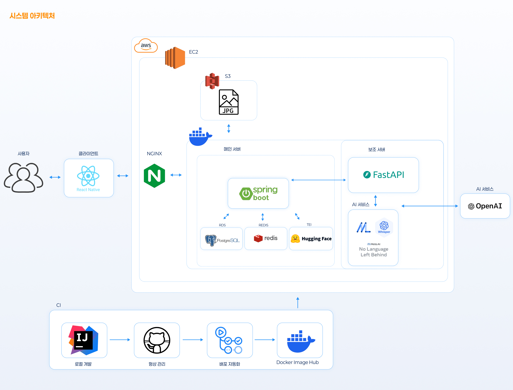
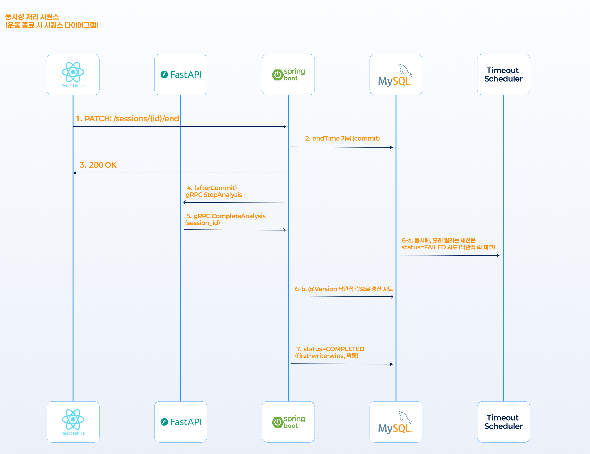

✍️Tech Stacks
---
     

⚙️ Projects
---
1. **[DOCKin](https://github.com/DOCKin-project/DOCKin-backend)**(2025.09 ~2026.09)

- 개요: 조선소 근로자를 위한 모바일 앱으로, AI 음성 인식, 다국어 번역, 안전 및 근태 관리 기능을 제공
-     
- 다국어 임베딩을 활용해 작업일지 교차언어 검색(RAG) 구현. 검색어와 문서의 언어가 달라도 서로 검색되도록 구성
- 검색 전에 사용자 권한을 적용하도록 설계. 검색 결과를 가져온 뒤 권한을 확인하면 접근할 수 없는 문서가 상위 결과를 차지해 실제 검색 결과가 부족해지는 문제를 방지
- 근태 처리 과정에서 발생하는 동시성 문제 해결. 중복 출근은 Redis 분산 락으로, 연차 차감은 비관적 락으로 막고 동시 요청 테스트로 검증
- 브루트포스 검색에 5,165ms가 걸리는 원인을 EXPLAIN으로 분석. 전체 시간의 81%가 DB 연산이 아닌 클라이언트로 데이터를 전송하는 데 쓰이는 것을 확인하고, 인덱스 없이 DB에서 계산을 마치도록 변경해 57ms로 단축
- batch_size=100을 설정했는데도 INSERT가 10,000번 발생하는 원인을 추적. IDENTITY 전략에서는 배치 INSERT가 동작하지 않는 것을 확인하고 SEQUENCE 전략으로 변경해 배치 처리 적용
- 컨테이너 CPU 상한을 설정하면 색인 속도가 빨라질 것이라는 가설을 세우고 직접 비교. 예상과 달리 CPU 상한을 없앴을 때 색인 속도가 17% 더 빨랐음을 확인

2. **[shadowfit](https://github.com/Shadowfit/backend)**(2026.03 ~10) 

- 개요: AI를 활용해 개인의 운동을 분석하고 관리하는 맞춤형 피트니스 앱
-   
- 실시간 관절 데이터 적재 파이프라인 구축. gRPC로 데이터를 모아 전달하고, 샘플 수를 줄인 뒤 묶어서 INSERT하도록 변경해 처리량 99% 증가, p99 지연 37% 감소
- 리포트 조회 쿼리 개선. 필요한 컬럼만 조회하고 키 기반 페이지네이션과 월별 파티셔닝을 적용해 1억 행 기준 데이터 전송량 98.7% 감소, 기간별 데이터 삭제 시간 66.5초에서 0.16초로 단축
- 세션 갱신 중 동시에 수정 요청이 들어오면 기존 값이 덮어써지는 lost update 문제 재현. 원자적 UPDATE, 비관적 락, 낙관적 락을 비교한 뒤 upsert와 '활성 세션은 1개만 유지한다'는 규칙을 적용해 충돌 방지
- 서킷브레이커가 AI 워커 3개(추출·시작·중단)의 실패율을 하나로 합산하던 문제 수정. JUnit 테스트로 ① 특정 워커가 멈춰도 전체 실패율이 낮아 서킷이 열리지 않는 경우 ② 한 워커에 요청이 몰리면 정상 워커까지 차단되는 경우를 재현하고, 워커별로 실패율을 따로 계산하도록 변경
-데드락 재시도에 걸리는 시간을 측정해 p50 584ms, p95 2.4s, p99 3.99s 확인. 기존에는 재시도 횟수만 기록하고 지연 시간은 수백 ms로 추정했으나, 실제 측정 결과 p99가 AI-Spring 간 gRPC 제한 시간인 5초에 근접함을 확인
- 쓰기 성능이 더 이상 개선되지 않는 원인을 커넥션 풀, 커밋 시 fsync, 부하 분산 순으로 추적. fsync가 병목이라는 가설을 검증한 결과, 부하가 한 세션에 집중될 때만 성립하는 것을 확인

⚙️ Open Source Contribution
---
- spring-projects/spring-ai #5297 - Elasticsearch IN/NIN 연산자 괄호 오류 수정 

- spring-projects/spring-security #18543 - AuthoritiesAuthorizationManager NPE 발생 오류 수정 

🎨 Activities
---

|Type| Contents | 내용 | Date |
| :---| :--- | :--- | :--- |
| 해커톤| 2025 k조선 해커톤| 산업통상자원부장관상 | '25. 09. 08. ~ '25. 11. 22. |
| 학술대회 | ACK 2026 Best Paper Award| 문서 AI 추출값의 근거 검증을 위한 저장 계층 파생 규칙 기법, Korea Information Processing Society ACK 최우수논문상 | '26. 11. 06. |

📝 Certificate
---
|Content| Date |
| :---|:--- |
|Adsp| '25.03. |
|정보처리기사| '26.09. |

